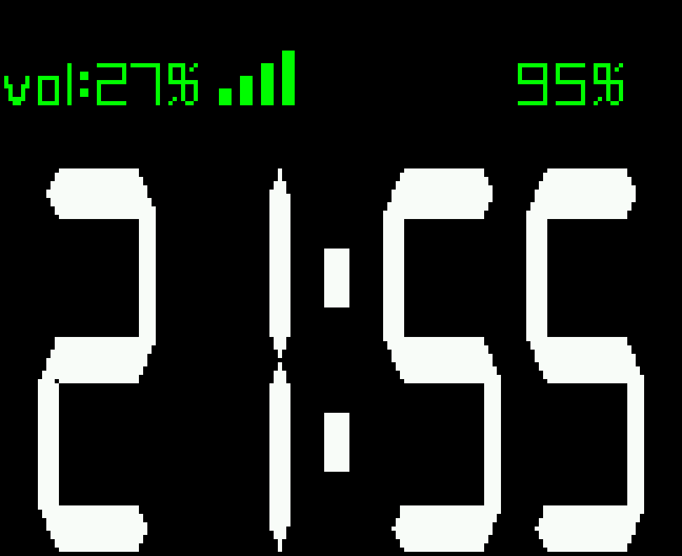

# AkuBox Sendspin Client

把 AkuBox（ARMv7 智能音箱）变成 **Music Assistant 的原生播放器**：MA 主动发现它、连上它、给它推流，
**不用改也不用升级 MA 服务端**。顺带把音箱那块 162×132 的小屏改成**黑胶唱片播放页**。

> 一台全新的 AkuBox，从零到能放歌 + 屏幕能转唱片：**一条命令，约 27 秒**（仓库自带预编译产物，不用编译）。

---

## 一、先看效果

| 播放时 · 专辑封面像黑胶一样转 | 停止 5 秒后 · 回到时钟 |
|:---:|:---:|
|  |  |

<sub>两张都是真机 `/dev/fb0` 抓帧（6 倍最近邻放大），不是效果图。</sub>

除了画面，你还会得到：

| 屏幕这块 | 你会得到 |
|---|---|
| 播放页 | 封面圆形旋转，130px 直径、24°/秒（约 15 秒一圈）、30fps 双线性采样 |
| 暂停/停止 | **立即停转**并停在当前角度（不清零），再播接着转，像被手按住又放开 |
| 时钟页 | 时间用大字号撑高再水平压窄（瘦高，实测 141×91），**白色**；日期星期已移除 |
| 顶部状态行 | `vol:NN%` / 充电图标 / 电量 `NN%` |
| CPU | 播放页 16-17%、时钟页几乎 0（这块屏在单核 1GHz 上很吃 CPU，已专门优化） |

---

## 二、适用设备与前提

| 项目 | 要求 |
|---|---|
| 设备 | AkuBox（`AKU R8-AkuBox`，ARMv7 单核 1GHz / 494 MB RAM） |
| 系统 | Ubuntu 22.04 armhf（glibc 2.35），`/dev/fb0` 为 st7735sfb 162×132 16bpp |
| 服务端 | Music Assistant **2.10.x**（官方附加组件，未修改） |
| 网络 | 设备与 MA 在**同一局域网**；设备是纯 WiFi 机型 |
| 权限 | 设备上能 `sudo` / root |

其它 armv7 设备理论上可用（脚本会自动探测声卡与混音器），但只在上述组合上做过真机验证。

---

## 三、快速开始（两步）

### 第 1 步：一条命令装好

```bash
git clone https://github.com/JochenZhou/akubox-sendspin.git /tmp/akubox-sendspin && \
sudo bash /tmp/akubox-sendspin/install.sh --name "客厅 AkuBox" -y
```

`--name` 是设备名（会显示在 MA 与 Home Assistant 里，**多台设备务必取不同名字**）；
不加 `-y` 会进入交互向导，逐步让你确认。GitHub 慢的话，可以先在自己电脑上 clone 再
`scp -r` 传过去 —— 脚本只依赖这个目录本身。

**这一条命令做了四件事**：

1. 装播放器 `sendspin-client`（用仓库 `prebuilt/` 里的产物，**不编译**）
2. 关闭 WiFi 省电（避免设备间歇性“失联”，见 [FAQ](#五常见问题)）
3. 装屏幕界面 `showtime`（黑胶播放页 + 时钟页，含字体）
4. 启动服务并自检（监听 8928、mDNS 广播、屏幕服务状态）

装完你会看到类似输出：

```
[✓] 服务已启动: sendspin-client
[✓] mDNS 已广播「客厅 AkuBox」
[✓] 屏幕服务 showtime: enabled / active
    屏幕界面: enabled / active
```

### 第 2 步：在 Music Assistant 里添加

1. 打开 MA → **设置 → 提供商 → Sendspin**
2. 打开该提供商页面（或重启一次 MA 附加组件），MA 会扫描局域网
3. 出现设备 `客厅 AkuBox` 后添加即可，HA 里会多出对应的 `media_player` 实体

> 💡 MA 的发现是**触发式扫描**，不是持续轮询：刚装完没立刻出现，进一次 Sendspin 提供商页面，
> 或重启 MA 附加组件就会扫到。实测有设备广播了 36 分钟才被 MA 注册的情况。

### 验证装好了（可选）

```bash
ss -tlnp | grep 8928                    # 应看到 sendspin-client 监听
journalctl -u sendspin-client -n 20     # 应看到 mDNS: Advertising ... + 连上后有 Connection admitted
systemctl is-active sendspin-client showtime
```

---

## 四、装完之后怎么用

### 播放 / 暂停

在 MA 或 Home Assistant 里选这台设备播放即可。屏幕会自动切换：**播放 → 黑胶；停止满 5 秒 → 时钟**。

音量用 MA/HA 的音量滑条，走的是硬件混音器（`0:Power Amplifier`，0-63）。

### 改名（不用重装、不用重编译）

```bash
sudo bash /tmp/akubox-sendspin/rename.sh                  # 只查看当前名称
sudo bash /tmp/akubox-sendspin/rename.sh "卧室 AkuBox"     # 改成新名称
```

它会更新配置 → 同步 systemd 单元 → 重启 → **读回客户端实际广播的名字**校验，并把原配置备份到
`/root/sendspin-rename-backup.<时间戳>/`。

> ⚠️ 客户端侧改名立即生效，但 **MA 的播放器对象名称是创建时固定的**，HA 里的实体名不会跟着变。
> 要一起改：MA → 设置 → 播放器 → 该设备 → 重命名（不影响播放功能）。

### 常用命令

```bash
journalctl -u sendspin-client -f               # 播放器实时日志
journalctl -u showtime -f                      # 屏幕程序日志
systemctl restart sendspin-client              # 重启播放器
systemctl restart showtime                     # 重启屏幕
sudo -u sendspin /usr/bin/sendspin-client -T   # 显示配对码
```

### 屏幕单独装 / 重装

```bash
sudo bash /tmp/akubox-sendspin/showtime/install-showtime-nowplaying.sh -y
```

### 卸载

```bash
sudo bash /tmp/akubox-sendspin/uninstall.sh
```

---

## 五、常见问题

排查顺序建议：**先看服务是否活着 → 再看网络是否可达 → 最后看协议/编码**。

### Q1：装完了，但 MA 里看不到设备

按这三步定位：

```bash
# 1) 服务在跑吗、在监听吗
systemctl is-active sendspin-client
ss -tlnp | grep 8928

# 2) mDNS 广播出去没有（在设备上看自己）
avahi-browse -rt _sendspin._tcp | grep -A4 AkuBox

# 3) MA 那边——直接重启一次 MA 附加组件强制重扫
```

判据很关键：

- **主机名能解析、但 `_sendspin._tcp` 里没有这台设备** → 客户端注册 mDNS 服务时静默失败了。
  原因几乎总是「avahi 和客户端被**同时**重启」——客户端抢在 avahi 就绪前注册，Bonjour 兼容层不报错。
  **修法：只重启客户端**（`systemctl restart sendspin-client`），绝不要连 avahi 一起重启。
- **服务根本没起来 / 没监听 8928** → 看 `journalctl -u sendspin-client -n 50`。

### Q2：设备 ping 不通、SSH 连不上，但它自己能上网

这是 **WiFi 省电**导致的 ARP 应答丢失，不是设备宕机。典型证据：设备能 clone GitHub、能推流，
但局域网内别人 `ping` 不通；在 PVE 上抓包能看到 `who-has <设备IP>` 请求发出、**零应答**。

```bash
# 在设备上关闭 WiFi 省电（一键脚本已自动做这一步）
U=$(nmcli -t -f UUID,DEVICE con show --active | awk -F: '/wlan0/{print $1}')
nmcli con mod "$U" 802-11-wireless.powersave 2
nmcli con up "$U"
```

设成 `2 (disable)` 后，从有线主机与同为 WiFi 客户端的主机实测全部可达。
临时应急也可以在连不上的主机上手工写邻居表验证链路：

```bash
ip neigh replace <设备IP> dev <网卡> lladdr <设备MAC> nud permanent
```

### Q3：MA 显示 playing，但喇叭没声音

**先看客户端的 `codec header` 那行和 decoder 报错**，不要先怀疑连接：

```bash
journalctl -u sendspin-client -n 100 | grep -Ei "codec header|decode|not whole frames"
```

- 看到 `Error decoding FLAC frame` → 服务端选了 FLAC 而本构建解不开
- 看到 `PCM chunk of ... is not whole frames` → 服务端协商到了 24/32-bit，分块不是整数帧

这两种都是「宣告了做不到的能力」。本仓库已改成**只宣告 16-bit PCM**，从根上避免。
另外确认声卡没被别的服务占用：`fuser -v /dev/snd/*`。

> ⚠️ 「重启客户端后声音回来了」通常只是服务端**重新协商**到了另一个格式 —— 那是绕过，不是修复。

### Q4：屏幕黑屏 / 有时钟但没有数字

三种可能，都对得上「服务 active、日志没报错、但屏幕不对」：

| 症状 | 原因 | 处理 |
|---|---|---|
| 全黑 | 屏幕程序是厂商的 **MQTT 版**（没消息就不画） | 装本仓库的 showtime：`install-showtime-nowplaying.sh -y` |
| 有时钟框、**没时间数字** | 缺字体或工作目录不对（`showtime` 用相对路径 `./wwDigital.ttf`） | 重跑屏幕安装脚本，会自动补字体 + 固定 `WorkingDirectory` |
| 整个不亮 | `showtime` 被停用 | `systemctl enable --now showtime` |

### Q5：`scp` 传文件到 AkuBox 报 Connection closed

该设备的 sftp 子系统不可用，用管道替代：

```bash
ssh root@<设备> 'base64 -d > /tmp/file' < <(base64 -w0 ./file)
```

### Q6：日志里有 `Malformed client/hello` 或 `InvalidFieldValue`

说明兼容补丁没生效（例如误加了 `--skip-legacy-ma-patch`）。重跑一键安装即可。

---

## 六、为什么要打这些补丁（原理）

上游 `TermeHansen/sendspin-client` 内嵌的 `sendspin-cpp` 是按 **aiosendspin 10.x** 的 wire shape 写的，
而当前稳定版 MA **2.10.x 固定在 aiosendspin 9.1.1**。两者在 Noise 握手、`client/hello`、
`client/state`、`server/command` 四个环节共 **7 处不兼容**，而且 MA 每次只报最外层的
`InvalidFieldValue`、不指出具体字段 —— 逐个手工排查非常耗时。

另外上游预编译的 armhf 包要求 `GLIBC_2.38` / `GLIBCXX_3.4.32`，AkuBox 是 glibc 2.35，
**用不了**（注意：这是说“上游官方包用不了”，不是说不能用预编译 —— 本仓库自编译的产物只要
`GLIBC_2.34`，并已放在 `prebuilt/` 里直接用）。

| # | 位置 | MA 2.10.x（aiosendspin 9.1.1）要的 | 上游 cpp 0.9.4 发的 | 处理 |
|---|---|---|---|---|
| 1 | Noise `msg1` | 只带 `psk_id`，**无** `psk_category` | 强制要求 category，缺失即握手失败 | 缺失时按 `lt → pr → sn` 顺序解析 PSK |
| 2 | `client/hello` → `supported_pair_methods` | **list**，每项含 `method` 字段 | dict `{名称: {}}` | 改为输出数组 |
| 3 | `client/hello` → `player@v1_support.supported_commands` | **必填**，值限 `volume`/`mute` | 省略（10.x 才可选） | 补 `["volume","mute"]` |
| 4 | `client/state` → `player` 延迟字段名 | `static_delay_ms` | `output_delay_ms`（后续版本改名） | **两个键都写**，旧服务端忽略多余键 |
| 5 | `client/state` → `player.supported_commands` | **只允许 `set_static_delay`** | `["volume","mute"]` | 改为只发 `set_static_delay` |
| 6 | `server/command` → `player.command` | 命令名 `set_static_delay`，值在 `static_delay_ms` | 只认 `set_output_delay` / `output_delay_ms` | **两种拼写都接受** |
| 7 | 宣告的编码与位深 | 从 `supported_formats` 里挑一项（按流的需求选，不一定取第一个） | 原本宣告 PCM + FLAC + OPUS × 16/24/32-bit | **只宣告 16-bit PCM** |

### 第 6 处：自己宣告的能力，自己解析不了

补丁 5 让客户端宣告支持 `set_static_delay`（9.x 校验只允许这个值）。MA 收到后**会真的把这条命令
发回来**用于同步播放延迟，但上游解析器只认 `set_output_delay`：

```
W sendspin.protocol: Ignoring field 'command': unknown value 'set_static_delay'
E sendspin.protocol: Invalid server player command
```

症状很轻（播放与音量都正常），但它是真缺陷：MA 永远无法同步该设备的输出延迟，多房间分组时对不齐。
修法是把旧拼写映射到同一命令、并补读 `static_delay_ms`。

> 教训：打「兼容旧服务端」的补丁时，要一并处理**旧服务端据此回发**的消息 —— 宣告一个能力就必须能解析对它的调用。

### 第 7 处：宣告了做不到的能力，等于给服务端留一条通往静音的合法路径

实测撞到两次，症状完全一样：协议层全通、连接 `ESTABLISHED`、没有连接错误，但**喇叭全程无声**。

**7a. FLAC 排在 PCM 前** → 服务端选了 FLAC，本构建解不开，整条流全丢。

**7b. 宣告了 24/32-bit** → 同步组下服务端选了 32-bit；`32-bit 立体声 = 8 字节/帧`，
而服务端分块是 9596 字节（`9596 % 8 = 4`），解码器要求整数帧、且调用方是**「全有或全无」**语义，
于是整块丢弃：不是断续、不是噪声，而是**彻底静默**。

**最终处理：只宣告 16-bit PCM。** `16-bit 立体声 = 4 字节/帧`，而服务端分块始终是 4 的整数倍
（实测 4404 与 9596 都是），必然对齐；同时不宣告 FLAC（解不开）与 OPUS（未验证）。
代价是放弃 24/32-bit —— 对这类小音箱没有实际损失。

启动日志里加了一行 `Advertising : N formats (pcm=N flac=N opus=N)`，方便把服务端的编码选择与宣告列表对起来。

---

## 七、屏幕界面的实现要点

- **帧缓冲是上下翻转的**：`fb_write_pixel()` 里 `mirrored_y = height - 1 - y`，所以**代码里 y 越大
  越靠屏幕上方**，可见行 ≈ `131 - (y + 字号)`。
- **`draw_text` 的 y 是基线、`draw_image` 的 y 是顶边**，同一个 y 两者差半个字高 —— 图标与文字
  对齐时要分别量可见行。
- **字体是隐身依赖**：`showtime` 用相对路径 `./wwDigital.ttf` 加载，路径相对**进程 CWD**。
  所以字体、`showtime.sh`、`WorkingDirectory` 三者缺一不可（缺了就是“服务正常但没数字”）。
- **封面**走 MA 的 imageproxy，统一请求 `size=160&fmt=png`（该接口只接受 80/160/256/512，
  且本机链接的是 libpng 而非 libjpeg），按 URL 哈希缓存在 `/tmp/showtime-cover-cache/`，
  面积平均缩放到 130×130；失败降级为深灰圆盘。
- **元数据不需要 MQTT / HA 自动化**：sendspin 协议本身就把 `title/artist/album/artwork_url`
  送到设备，客户端补丁 `0003` 把它写成 `key=value` 小文件
  （`/var/lib/sendspin-client/nowplaying`），屏幕程序每秒读一次。

### 性能：这块屏很容易吃掉整个 CPU

单核 1GHz 的 ARMv7。实测踩过两个坑，都不是“画得慢”：

1. **厂商代码每帧 fork 一条 shell 管道**：`get_current_volume_s()` 内部是
   `popen("amixer get ... | grep ... | awk ...")`，一次调用 fork 4 个进程，而它在循环顶部**每帧**
   调用。1fps 时无感，30fps 就变成 64 次 fork/秒，白烧 **~60% 单核**。
   症状很骗人：`/proc/stat` 显示 96% 忙，但进程表只解释 35% —— 缺的都在短命进程里。
   修法：音量文字只在时钟页用，把查询挪进时钟分支（fork 速率 64 → 0.9 次/秒）。
2. **逐像素浮点在这颗 CPU 的 VFP 上很慢**（实测 1e6 次 float 乘加要 70ms）。
   改成 16.16 定点整数 + 直写后备缓冲：每帧 **14-19ms → 2.6-4.4ms**。

帧率也不是越高越好（实测）：30fps → 16-17%，40fps → 20-23%，**50fps → 36%**（每帧反而变慢）。
24°/秒 的转速在 30fps 下每帧只转 0.8°，看不出台阶，所以定档 30fps。

修复前后：showtime **57% → 16-17%**，整机 **96% → 21-23%**。
完整参数表、以及“怎么验证画面真的对（而不是只看非黑占比）”见 [`showtime/README.md`](showtime/README.md)。

---

## 八、进阶：源码编译与可复现性

### 用仓库自带的预编译产物（默认）

`prebuilt/` 里有三个文件（含 `SHA256SUMS`）：播放器、屏幕程序、屏幕字体。
一键脚本发现它们就直接用，**约 27 秒**装完。详见 [prebuilt/README.md](prebuilt/README.md)。

想换成别的产物（例如另一台设备上编译的）：

```bash
sudo bash install.sh --client-bin  /tmp/sendspin-client.armv7 \
                     --display-bin /tmp/showtime.armv7 --name "客厅 AkuBox" -y
```

脚本会依次校验：`ELF 32-bit ARM` → `ldd` 无缺失 → **三个补丁标记齐全**
（`(legacy server); trying all` / `Advertising   : %zu formats` / `/nowplaying`），
任一不过直接拒绝，不会把不兼容的二进制刷上去。

### 强制源码编译

```bash
# 播放器：单核 ARM 约 30-40 分钟
sudo bash install.sh --build-only          # 只编译
sudo bash install.sh --name "X" -y --no-display   # 删掉 prebuilt/sendspin-client.armv7 后即走源码

# 屏幕：需要厂商源码 /opt/aku/showtime/showtime.c（部分固件批次只发二进制）
sudo bash showtime/install-showtime-nowplaying.sh --force-build -y
```

**版本锁定**（保证可复现）：

| 组件 | 版本 | 提交 |
|---|---|---|
| `TermeHansen/sendspin-client` | v0.5.2 | `b3d209f93bdd2f6e88174963dc2aeda36c2baf63` |
| `sendspin-cpp`（子模块） | v0.9.4 | `81216ba634d5b396862de2ef545fc1b17ffeb3f3` |

补丁以 `git apply` 方式应用；上游代码变动导致补丁无法干净应用时，脚本会**明确报错退出**，
不会静默产出错误二进制。

### 配置项

`/etc/sendspin-client/sendspin-client.conf`：

```ini
FRIENDLY_NAME="客厅 AkuBox"
AUDIO_DEVICE="plughw:0,0"
ALSA_MIXER_SPEC="0:Power Amplifier"
LOG_LEVEL="info"
IDLE_TIMEOUT=0
LIVENESS_TIMEOUT=60
RECONNECT_ON_LOSS=true
UNPAIRED_ACCESS=true
```

> ⚠️ **不要设置 `CONNECT_URL`。** 客户端是**监听模式**（默认 8928）+ mDNS 广播，由 MA 主动连入。
> 设了 `CONNECT_URL` 会变成“客户端出站连 MA”的反向流程，握手必然失败。

改名只需改 `FRIENDLY_NAME` 再重启 —— 配置**优先于** systemd 单元里的命令行参数。

### 已验证环境

| 项目 | 值 |
|---|---|
| 设备 | AkuBox（ARMv7 单核、494 MB RAM、UBI rootfs） |
| 系统 | Ubuntu 22.04.5 LTS |
| 声卡 | `sun4icodec` → `plughw:0,0`，混音器 `0:Power Amplifier` |
| 服务端 | Music Assistant **2.10.6**（官方附加组件，未修改） |
| 实际播放验证 | 播完 372 秒整曲，零解码错误 |
| 音量控制验证 | HA `volume_set 0.6` → 硬件混音器 12→50（0-63）正确跟随 |
| 日志洁净度 | 连接/播放期间无任何 protocol / decoder 报错 |

### 已知限制

- **状态级音量命令**：补丁 5 让 `client/state` 只声明 `set_static_delay`（9.x 的硬性要求），
  因此音量/静音通过 **hello 层**声明，在 MA 2.10.x 下工作正常。将来若升级到 aiosendspin 10.x 的 MA，
  可能需要 `--skip-legacy-ma-patch` 重新编译以恢复 10.x 原生的状态级音量控制。
- 仅在上述 AkuBox / Ubuntu 22.04 / MA 2.10.6 组合上做过真机验证。

---

## 九、仓库结构

```
.
├── install.sh                               # 一键安装（默认用 prebuilt/，免编译）
├── rename.sh                                # 安装后改名（无需重新编译）
├── uninstall.sh                             # 卸载
├── patches/                                 # 对上游客户端的补丁
│   ├── 0001-sendspin-cpp-legacy-ma-compat.patch      # 差异 1-6
│   ├── 0002-sendspin-client-16bit-pcm-only.patch     # 差异 7
│   └── 0003-sendspin-client-nowplaying-bridge.patch  # 曲目落盘（供屏幕显示）
├── prebuilt/                                # 仓库自带的预编译产物
│   ├── sendspin-client.armv7                # 播放器（含 7 处补丁）
│   ├── showtime.armv7                       # 屏幕程序（黑胶 + 时钟）
│   ├── fonts/wwDigital.ttf                  # 屏幕字体
│   ├── SHA256SUMS
│   └── README.md
├── showtime/                                # 屏幕界面
│   ├── README.md
│   ├── install-showtime-nowplaying.sh
│   ├── screenshots/{player-vinyl,clock}.png
│   └── patches/showtime-nowplaying.patch
├── config/sendspin-client.conf.example
└── systemd/sendspin-client.service
```

## 十、许可

脚本与补丁以 **MIT** 发布。上游 `sendspin-client` / `sendspin-cpp` 为 **Apache-2.0**；
`prebuilt/` 里的 `showtime.armv7` 与 `wwDigital.ttf` 是 AkuBox 厂商随设备提供的程序/字体的
编译产物，非开源软件，仅作**互操作性用途**提供给同型号设备机主（详见
[prebuilt/README.md](prebuilt/README.md)）。权利人如有异议请联系移除。

## 十一、致谢

- [TermeHansen/sendspin-client](https://github.com/TermeHansen/sendspin-client)
- [Sendspin](https://github.com/Sendspin) 协议与 `sendspin-cpp`
- [Music Assistant](https://github.com/music-assistant/server)
